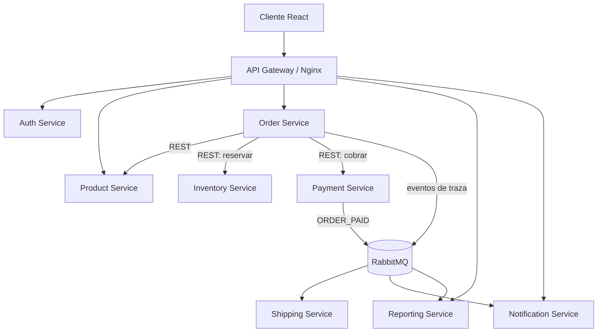

# ShadowBytes SOA Demo Platform

Sistema académico de comercio electrónico para demostrar una Arquitectura Orientada a Servicios (SOA) en tiempo real. Un pedido atraviesa autenticación, catálogo, inventario y pagos de manera síncrona; al confirmarse, RabbitMQ distribuye el evento a envíos, notificaciones y reportes de forma asíncrona.

## Mission Control: dos modos para una exposición segura

- **Sandbox:** un laboratorio interactivo tipo TryHackMe que funciona sólo en el navegador. Simula JWT, REST, RabbitMQ, eventos y fallos aislados sin Docker ni internet.
- **Live:** conecta el mismo panel al gateway, servicios FastAPI y RabbitMQ reales definidos en Docker Compose.

El panel incorpora las ocho imágenes de la presentación en **Academia SOA**. Cada tema se enlaza con una misión concreta para que la exposición conecte la explicación con una evidencia en vivo.

## Qué está implementado en este MVP

- Frontend React/Vite con Mission Control, Academia SOA y Playbook de retos.
- API Gateway Nginx como único acceso HTTP a las APIs públicas.
- Autenticación JWT con los roles `USER` y `ADMIN`.
- Servicios FastAPI independientes para Auth, Users, Products, Orders, Inventory, Payments, Shipping, Notifications y Reports.
- Orquestación síncrona `Orders → Products → Inventory → Payments` mediante REST/JSON.
- Bus de eventos RabbitMQ de tipo fanout para `ORDER_PAID`, `ORDER_CREATED` e `INVENTORY_RESERVED`.
- Consumidores desacoplados de Envíos, Notificaciones y Reportes, con colas durables propias.
- Endpoints `/health` y observabilidad visual del servicio caído.
- Límite básico de peticiones en el endpoint de pedidos del gateway.

> [!IMPORTANT]
> Es una demostración local. Los usuarios, el inventario y los pedidos viven en memoria para que el flujo sea fácil de explicar. Los secretos de ejemplo y las credenciales de RabbitMQ no son aptos para producción.

## Arquitectura



El detalle de decisiones, contratos y evolución está en [docs/architecture.md](docs/architecture.md). La secuencia para presentar el sistema está en [docs/demo-script.md](docs/demo-script.md).

## Arranque local

Requisitos: Docker Desktop con Docker Compose v2.

> [!TIP]
> ¿Ves el error `docker no se reconoce`? Sigue la guía de [Docker Desktop en Windows](docs/docker-desktop-windows.md). Mientras lo instalas, puedes abrir el panel en modo Sandbox con `pnpm run dev` dentro de `frontend`.

### Abrir Sandbox sin Docker

Requiere Node.js 22 o superior. Esta modalidad no requiere RabbitMQ, FastAPI ni credenciales.

```powershell
cd D:\proyects\shadow-bytes-SOA\frontend
corepack enable
pnpm install
pnpm run dev
```

Abre la dirección que muestra Vite (normalmente `http://localhost:5173`) y usa **Sandbox**.

```powershell
cd D:\proyects\shadow-bytes-SOA
docker compose up --build
```

Abre estos recursos:

- Panel de demostración: [http://localhost:3000](http://localhost:3000)
- API Gateway: [http://localhost:8080/health](http://localhost:8080/health)
- RabbitMQ Management: [http://localhost:15672](http://localhost:15672) — usuario `shadowbytes`, contraseña `shadowbytes`

El archivo `.env.example` contiene los valores de demostración. Para personalizarlos, cópialo a `.env`; Docker Compose usará automáticamente esos valores.

```powershell
Copy-Item .env.example .env
```

## Cuentas de demostración

- Usuario: `student@shadowbytes.local` / `demo123`
- Administrador: `admin@shadowbytes.local` / `admin123`

## Demostrar bajo acoplamiento

Con el sistema iniciado, crea un pedido y mira los eventos. Luego detén solo el consumidor de notificaciones:

```powershell
docker compose stop notification-service
```

El panel marcará Notificaciones como caído. Los pedidos, pagos, RabbitMQ, envíos y reportes seguirán operativos; los eventos de notificación quedarán acumulados en su cola durable. Para restaurarlo:

```powershell
docker compose start notification-service
```

## Estructura

```text
shadow-bytes-SOA/
├── frontend/                 # Panel React/Vite y proxy del navegador al gateway
│   └── public/presentacion/  # Diapositivas integradas en Academia SOA
├── gateway/                  # Enrutamiento, encabezados y rate limit de Nginx
├── services/
│   ├── common/               # JWT, contratos de evento y utilidades compartidas
│   ├── auth/ users/ products/ orders/ inventory/ payments/
│   └── shipping/ notifications/ reports/
├── database/                 # Diseño para persistencia por servicio (fase siguiente)
├── monitoring/               # Diseño para Prometheus/Grafana (fase siguiente)
├── img/                      # Archivos originales de la presentación
├── docs/                     # Arquitectura y guion de presentación
├── .github/workflows/        # Verificación y despliegue del Sandbox
└── docker-compose.yml
```

## Publicar el Sandbox

Al hacer push a `main`, GitHub Actions compila y publica la versión Sandbox en GitHub Pages. Consulta [docs/deployment.md](docs/deployment.md): GitHub Pages comparte el laboratorio y las diapositivas, mientras que el modo Live requiere un servidor Docker para ejecutar RabbitMQ y FastAPI.

## Verificación rápida por API

Inicia sesión a través del gateway:

```powershell
Invoke-RestMethod -Method Post -Uri http://localhost:8080/api/auth/login -ContentType 'application/json' -Body '{"email":"student@shadowbytes.local","password":"demo123"}'
```

Consulta los eventos que consume Reporting Service:

```powershell
Invoke-RestMethod http://localhost:8080/api/reports/reports/events
```

## Siguientes fases

1. Añadir PostgreSQL con una base lógica por servicio y migraciones.
2. Sustituir la publicación directa por el patrón transactional outbox.
3. Añadir Prometheus, Grafana y métricas HTTP por servicio.
4. Terminar TLS en Nginx y mover la validación JWT al gateway con `auth_request` o un proveedor de identidad.
5. Persistir y proteger carritos si se quiere demostrar un servicio con estado.
