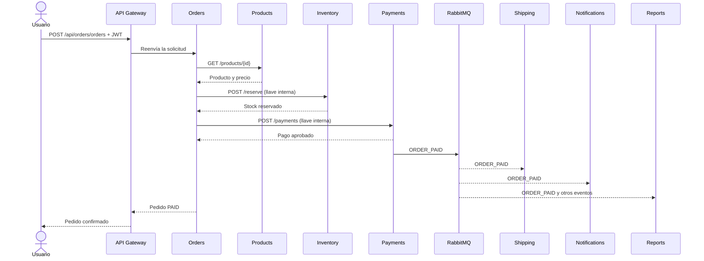
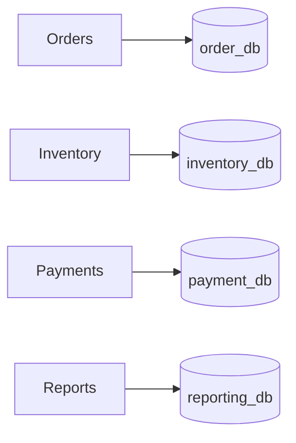

# Arquitectura del MVP

## Decisión de alcance

El plan completo contiene infraestructura de producción. Para que la primera demostración sea ejecutable, el MVP conserva todos los límites de servicio, el gateway, JWT, REST, RabbitMQ y el panel en vivo, pero usa estado en memoria en vez de PostgreSQL/Prometheus/Grafana. Esta decisión reduce el tiempo de instalación y hace visible el concepto principal: cada contenedor tiene una responsabilidad y puede fallar de forma aislada.

## Límites y responsabilidades

- **Auth Service:** valida las cuentas de demostración y firma el token JWT.
- **User Service:** expone el perfil del usuario autenticado.
- **Product Service:** es dueño del catálogo y de los precios.
- **Order Service:** orquesta la compra; no descuenta stock ni procesa pagos internamente.
- **Inventory Service:** reserva stock bajo una llave de servicio interna.
- **Payment Service:** simula el cobro y publica `ORDER_PAID`.
- **Shipping Service:** consume pagos confirmados y prepara el envío.
- **Notification Service:** consume pagos confirmados y registra una notificación.
- **Reporting Service:** consume todos los eventos y alimenta el panel en vivo.
- **API Gateway:** centraliza el ingreso, las rutas públicas, las cabeceras y el rate limit de pedidos.

## Contratos públicos relevantes

Todos llegan por `http://localhost:8080/api` durante el desarrollo.

- `POST /auth/login`: recibe correo y contraseña; devuelve el JWT y el rol.
- `GET /auth/me`: valida el JWT y devuelve su identidad.
- `GET /products/products`: retorna el catálogo público.
- `POST /orders/orders`: requiere `Authorization: Bearer <JWT>`; crea una compra.
- `GET /orders/orders`: requiere JWT; lista pedidos propios, o todos si el rol es `ADMIN`.
- `GET /reports/reports/events`: devuelve la última traza de eventos para el panel.
- `GET /notifications/notifications`: devuelve notificaciones procesadas.
- `GET /monitor/{servicio}`: consulta solamente el health check del servicio solicitado.

Los endpoints de Inventario y Pagos no son publicados por el gateway. Order Service los invoca desde la red interna usando `X-Internal-Key`.

## Eventos y bajo acoplamiento

RabbitMQ emplea el intercambio fanout `shadowbytes.events`. Cada consumidor tiene su propia cola durable:

- `shipping.events`
- `notification.events`
- `reporting.events`

`Payment Service` publica `ORDER_PAID` solo después de aprobar el pago. `Order Service` emite `ORDER_CREATED`, `INVENTORY_RESERVED`, `STOCK_REJECTED` y `PAYMENT_DECLINED` para que la traza permita explicar las decisiones síncronas. Envíos y Notificaciones filtran y procesan exclusivamente `ORDER_PAID`, y publican respectivamente `SHIPMENT_PREPARED` y `NOTIFICATION_SENT`; Reportes registra todos los tipos.

Al detener `notification-service`, RabbitMQ continúa aceptando el evento y conserva la entrega para su cola. Payment Service no conoce ni espera al consumidor: ésa es la prueba de bajo acoplamiento.

## Seguridad actual y evolución

El frontend recibe un JWT de corta vida y lo presenta al acceder a pedidos o perfiles. Auth, Users y Orders verifican la firma y el rol. Nginx OSS enruta y limita el tráfico; no valida JWT por sí mismo, porque esa característica exige una solución adicional como `auth_request`, OPA o Nginx Plus. Esta separación está documentada para no presentar como implementada una función inexistente.

Para producción deben usarse secretos administrados, hash de contraseñas, TLS, CORS restrictivo, rotación de claves, rate limits por identidad, autorización granular y auditoría de accesos.

## Persistencia y monitoreo previstos

La evolución no deberá usar una base compartida. Cada dueño de datos tendrá una base o esquema aislado:

El próximo corte incorporará métricas Prometheus (`requests`, latencia, errores y consumidores) y un dashboard Grafana. El panel actual es observabilidad funcional para la exposición; no reemplaza monitoreo operacional.
